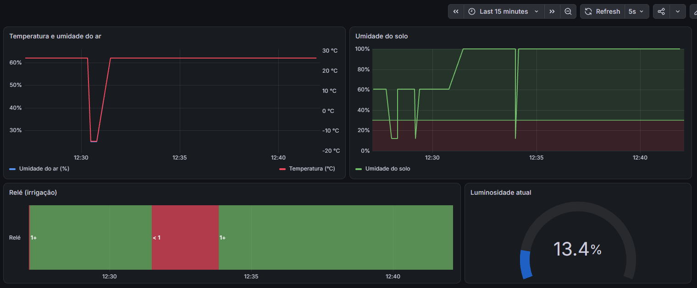
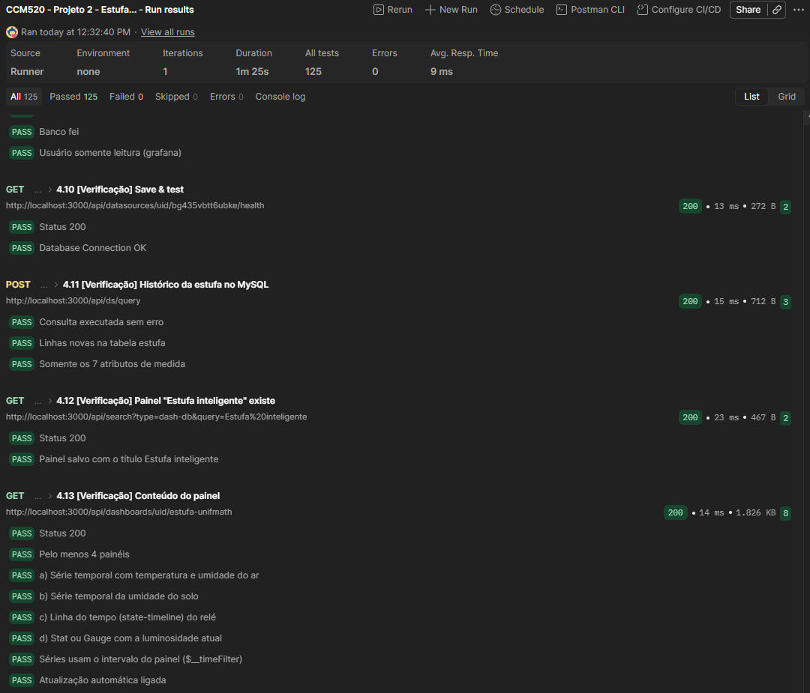

# Estufa inteligente na plataforma FIWARE — Grupo `unifmath`

> Projeto 2 da disciplina CCM520 – Internet das Coisas (Centro Universitário FEI).

**Integrante:** Matheus Concon de Oliveira (22.124.089-8)
**Link do Wokwi:** <https://wokwi.com/projects/480488370837301249>

## 1. Descrição

A estufa monitora temperatura e umidade do ar (DHT22), umidade do solo (sensor capacitivo, simulado por um potenciômetro no Wokwi) e luminosidade (LDR). Ela aciona um relé de irrigação e um servomotor que abre a janela. A ESP32 publica as medidas no broker público da HiveMQ. Uma ponte MQTT filtrada pela API key `unifmath` leva esses tópicos até o Mosquitto local, onde o IoT Agent JSON os traduz para a entidade `urn:ngsi-ld:Greenhouse:001` no Orion. A partir do Orion, as aplicações leem o estado, enviam comandos, recebem o alerta de solo seco (consumidor) e consultam o histórico (Cygnus → MySQL → Grafana) sem falar MQTT.

## 2. Arquitetura

```
              INTERNET                                         COMPUTADOR (Docker)
 ┌──────────────┐  MQTT 1883  ┌───────────────────┐ ponte  ┌──────────────────────────────────────────────────────┐
 │ ESP32/Wokwi  │────────────►│ broker.hivemq.com │◄══════►│ Mosquitto :1883 ◄─MQTT─► IoT Agent JSON :4041          │
 │ estufa001    │◄────────────│  (público)        │ 1883   │  (só tópicos unifmath)          │ NGSI-v2 HTTP         │
 └──────────────┘             └───────────────────┘        │                                 ▼                      │
 ┌──────────────┐  WSS 8884          ▲                     │                      Orion :1026 ◄─► MongoDB :27017    │
 │ HiveMQ Web   │────────────────────┘                     │            subscrições  │ HTTP                         │
 │ Client       │                                          │     ┌───────────────────┴─────────┐                    │
 └──────────────┘                                          │     ▼ keyValues                    ▼ normalized         │
                                                           │ consumidor :3000 (host 3001)   Cygnus :5050             │
                                                           │                                    │ JDBC               │
                                                           │                  Grafana :3000 ◄── MySQL :3306          │
                                                           └──────────────────────────────────────────────────────┘
   Postman (host) ──HTTP──► IoT Agent :4041 (provisionamento) e Orion :1026 (comandos, consultas, subscrições)
```

## 3. Hardware

| Componente | Pino da ESP32 | Observação |
| --- | --- | --- |
| DHT22 | GPIO4 | alimentação 3V3 |
| Umidade do solo | GPIO34 (ADC1_CH6) | no Wokwi: potenciômetro (SIG) |
| LDR | GPIO35 (ADC1_CH7) | módulo fotoresistor, saída AO |
| Relé | GPIO26 | alimentação 5V; no Wokwi aciona um LED azul ("irrigação") |
| Servomotor | GPIO27 | alimentação 5V, PWM 50 Hz |

**Calibração:** as duas grandezas analógicas são convertidas por uma reta entre dois pontos medidos no ADC (0 a 4095, atenuação 11 dB), limitada a 0–100 %:

- **Umidade do solo:** o sensor capacitivo fornece tensão **maior com o solo seco**. Referências: `SOLO_ADC_SECO = 4095` → 0 % e `SOLO_ADC_MOLHADO = 0` → 100 %. No Wokwi, girar o potenciômetro para a direita seca o solo. Na placa real, troque pelos valores lidos com o sensor no ar e no copo d'água.
- **Luminosidade:** a saída AO do módulo LDR **cai com mais luz**. Referências: `LUZ_ADC_ESCURO = 4095` → 0 % e `LUZ_ADC_CLARO = 0` → 100 %.

## 4. Identificadores

| Item | Valor |
| --- | --- |
| API key | `unifmath` |
| Client id da ponte | `ponte_unifmath` |
| `fiware-service` / `fiware-servicepath` | `fei` / `/estufa` |
| `device_id` | `estufa001` |
| Entidade | `urn:ngsi-ld:Greenhouse:001` (`Greenhouse`) |
| Client id MQTT da ESP32 | `esp32_unifmath_estufa001` |

## 5. Modelo de dados

### 5.1 Medidas

| `object_id` (firmware) | Atributo NGSI | Tipo | Unidade / faixa |
| --- | --- | --- | --- |
| `t` | `temperature` | Number | °C |
| `ur` | `relativeHumidity` | Number | % |
| `us` | `soilMoisture` | Number | % |
| `lum` | `illuminance` | Number | % |
| `rel` | `relayState` | Number | 0/1 |
| `jan` | `windowAngle` | Number | 0–180 |
| `int` | `samplingInterval` | Number | s |

Exemplo de payload publicado: `{"t": 26.5, "ur": 62.0, "us": 70.7, "lum": 48.3, "rel": 0, "jan": 0, "int": 3}`

Atributos estáticos: `name` (Text) = `Estufa inteligente unifmath`; `location` (geo:json) = `Point [-46.5797, -23.7245]` (campus da FEI, São Bernardo do Campo).

### 5.2 Comandos

| Comando | Valores aceitos | Resposta de sucesso | Respostas de erro |
| --- | --- | --- | --- |
| `setRelay` | 0 ou 1 | `OK` | `ERRO: setRelay aceita 0 ou 1`, `ERRO: valor deve ser um numero`, `ERRO: valor deve ser inteiro` |
| `setServo` | 0 a 180 | `OK` | `ERRO: setServo aceita 0 a 180`, `ERRO: valor deve ser um numero`, `ERRO: valor deve ser inteiro` |
| `setInterval` | 2 a 10 (s) | `OK` | `ERRO: setInterval aceita 2 a 10`, `ERRO: valor deve ser um numero`, `ERRO: valor deve ser inteiro` |
| `setSending` | 0 ou 1 | `OK` | `ERRO: setSending aceita 0 ou 1`, `ERRO: valor deve ser um numero`, `ERRO: valor deve ser inteiro` |
| outro nome | — | — | `ERRO: comando desconhecido` |

O valor é aceito como `1`, `"1"` ou `1.0`. Valores não inteiros (`1.5`), texto, `nan` e números enormes são recusados sem travar o programa. Valor inválido nunca altera o estado.

### 5.3 Tópicos MQTT

| Sentido | Tópico |
| --- | --- |
| Medidas | `/json/unifmath/estufa001/attrs` |
| Comandos | `/unifmath/estufa001/cmd` |
| Resultado | `/json/unifmath/estufa001/cmdexe` |

### 5.4 Ponte com o broker público

| Padrão | Direção | Por quê |
| --- | --- | --- |
| `/json/unifmath/estufa001/attrs` | `in` | a estufa publica as medidas no broker público; elas precisam chegar ao IoT Agent local |
| `/json/unifmath/estufa001/cmdexe` | `in` | a estufa publica o resultado dos comandos no público; o IoT Agent atualiza `_status`/`_info` |
| `/unifmath/estufa001/cmd` | `out` | o IoT Agent publica os comandos no broker local; eles precisam chegar à estufa no público |

## 6. Como reproduzir

1. **Clone** o repositório e abra o Docker Desktop. Encerre os ambientes das Aulas 8 e 9 (`docker compose down`).
2. **Ponte:** `plataforma/mosquitto/mosquitto.conf` já está com a API key `unifmath`.
3. **Suba o ambiente:** `cd plataforma`, depois `docker compose up -d` e `docker compose ps`. Ao final, os 9 contêineres aparecem como `healthy`. Em `docker compose logs mosquitto`, `Connecting bridge hivemq` aparece só uma vez.
4. **Teste da ponte:** em um terminal, rode `docker exec -it mosquitto mosquitto_sub -v -t "#"`. No HiveMQ Web Client, publique `oi` em `/json/unifmath/estufa001/attrs`. A mensagem aparece no terminal local.
5. **Postman:** importe `postman/Projeto 2.postman_collection.json`, confira a variável `apikey = unifmath` e rode a pasta *Etapa 1*. Todos os testes ficam verdes.
6. **Provisionamento:** rode 2.1, 2.2 e 2.3. Publique `{"t": 25}` em `/json/unifmath/estufa001/attrs` pelo Web Client e rode 2.4. A entidade passa a ter `temperature = 25`.
7. **Firmware:** crie um projeto ESP32 MicroPython no Wokwi com o circuito da seção 3 e o conteúdo de `firmware/main_esqueleto.py` como `main.py` e clique em *Play*. O Serial Monitor mostra `medidas -> {...}` a cada 3 s. Rode 3.1 a 3.15.
8. **Subscrições:** rode 4.1 a 4.8. As linhas aparecem na tabela `estufa` do MySQL e o alerta chega a `http://localhost:3001/notificacoes?caminho=/alerta-estufa`.
9. **Grafana:** em <http://localhost:3000> (admin/admin), crie a fonte de dados MySQL (`mysql-db:3306`, banco `fei`, usuário `grafana`/`grafana2026`). Importe `plataforma/painel-estufa.json` em *Dashboards → New → Import*. Rode 4.9 a 4.13.
10. **Coleção inteira:** rode a pasta 0 e depois a coleção completa no Runner, com a estufa ligada. Exporte o resultado para `postman/`.

## 7. Subscrições

| Subscrição | Condição | Destino | Atributos e formato | Por que assim |
| --- | --- | --- | --- | --- |
| Histórico | qualquer mudança de entidades `Greenhouse` (`idPattern .*`) | `http://cygnus:5050/notify` | os 7 atributos de medida, `normalized` | o Cygnus só aceita `normalized`; comandos e estáticos ficam de fora para não poluir o histórico; quem notifica é o Orion, dentro da rede Docker |
| Alerta de solo seco | `q: soilMoisture<30`, avaliada quando `soilMoisture` muda | `http://consumidor:3000/alerta-estufa` | `soilMoisture`, `relayState`, `TimeInstant`, `keyValues`, `throttling: 30` | o serviço externo precisa só dos valores; o `throttling` evita uma notificação a cada medida enquanto o solo continua seco |

## 8. Painel



- **Temperatura e umidade do ar** (time series): `attrName IN ('temperature','relativeHumidity')`, com a coluna `metric` separando as séries.
- **Umidade do solo** (time series): `attrName = 'soilMoisture'`, com uma faixa vermelha abaixo de 30 % (limite do alerta).
- **Relé** (state timeline): `attrName = 'relayState'`, com 0 mostrado como "Desligado" e 1 como "Ligado".
- **Luminosidade atual** (gauge): último valor de `illuminance`.
- Atualização automática a cada 5 s. O JSON está em `plataforma/painel-estufa.json`.

## 9. Testes

A coleção inteira foi executada no Runner do Postman com a estufa ligada: **125 testes aprovados e 0 falhas** (12/11/2026). O resultado exportado está em `postman/`.



## 10. Decisões de projeto e limitações

- **object_id curtos** (`t`, `ur`, `us`...) reduzem o tamanho do payload e ficam documentados na seção 5.1.
- **Validação dos comandos:** o firmware converte o valor com `float()` e exige que seja inteiro e esteja dentro da faixa. Qualquer erro devolve `ERRO: <motivo>` sem alterar o estado.
- **DHT22:** o sensor só aceita uma leitura a cada 2 s, então o firmware reaproveita a última leitura quando publica logo depois de um comando. Se a leitura falhar (`OSError`), a medida daquele ciclo é descartada e o programa continua.
- **Conexão com `setSending = 0`:** sem medidas, a ESP32 não publicaria nada e o broker a desconectaria pelo keepalive (60 s). Um `ping()` a cada 30 s mantém a conexão, e os comandos continuam chegando.
- **Laço não bloqueante:** o laço usa `check_msg()` e `ticks_diff`, sem `time.sleep()` e sem `wait_msg()`.
- **Reconexão (D.2):** um `OSError` em `check_msg()`, `ping()` ou `publish()` marca a conexão como perdida. O laço principal tenta reconectar a cada 5 s, sem `time.sleep()`, e a cada reconexão assina de novo o tópico de comandos, porque o broker esquece as assinaturas do cliente que caiu. Comandos enviados durante a queda se perdem e ficam `PENDING` no Orion até serem reenviados.
- **Limitações:** o broker público não tem autenticação nem TLS, então qualquer pessoa que conheça a API key pode ler as medidas e enviar comandos falsos. Em um sistema real, usaríamos um broker próprio com usuário e senha por dispositivo, ACL por tópico e TLS. O potenciômetro do Wokwi só imita o sensor de solo, então a calibração real precisa ser refeita na placa.

## 11. Desafios realizados

- **D.2 – Reconexão:** em `firmware/main_esqueleto.py`, seção 6 (funções `conectar_broker()` e `conexao_perdida()`) e início do laço principal.

## 12. Uso de ferramentas de IA

O Claude (Anthropic) foi usado como apoio na revisão e na redação da documentação final (README), a partir dos arquivos do projeto e do material da disciplina. O conteúdo foi conferido pelo autor.

## 13. Referências

- Material das Aulas 5 a 9 da disciplina CCM520.
- FIWARE IoT Agent JSON: <https://fiware-iotagent-json.readthedocs.io>
- FIWARE Orion (NGSI-v2): <https://fiware-orion.readthedocs.io>
- HiveMQ MQTT Essentials: <https://www.hivemq.com/mqtt/>
- Wokwi – ESP32 MicroPython: <https://docs.wokwi.com>
